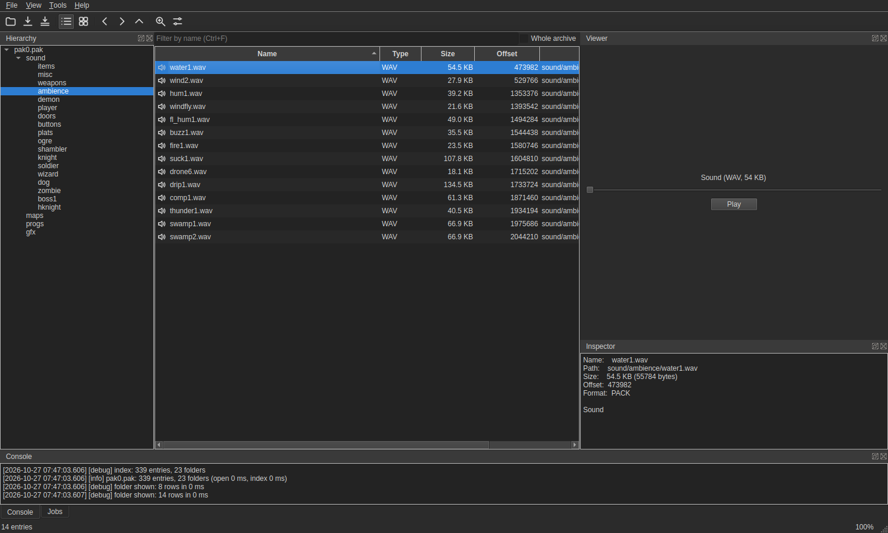

<p align="center">
  
</p>

<h1 align="center">Dragon UnPACKer++</h1>

<p align="center">
  A fast, cross-platform explorer and extractor for the resource files of games.<br>
  Open an archive, browse it like a folder, preview what is inside and extract it.
</p>

<p align="center">
  
</p>

Dragon UnPACKer++ continues **Dragon UnPACKer**, created by Alexandre "Elbereth" Devilliers ([official website](https://www.elberethzone.net/dragon-unpacker.html)). It is a port to C++20 with a Qt 6 interface for Linux (Windows is next), with a driver that understands 126 container formats, and with features that version 5 did not have.

## Credits

- **Alexandre "Elbereth" Devilliers**: original author of Dragon UnPACKer (versions 1 to 5, Delphi): the program, its plugin system, the formats and the HyperRipper that this project is built on. All of the original ideas and many of the format layouts are his work.
- **Tiglate Pileser III**: the port to C++20 and Qt 6, the new driver, and the new features (Unity, FMOD, XNA and Unreal readers, previews, file type identification, list templates, converters, translations...).
- **Crack dot Com**, the authors of Abuse (public domain source) and **Abuso**, its modern iteration (MIT), from whose sources the SPE and DPA readers were written.
- Everyone who gave formats, plugins, translations and bug reports to Dragon UnPACKer over the years.

Dragon UnPACKer++ is free software under the [Mozilla Public License 2.0](LICENSE). The original v5 sources are in the git history (tag `legacy-v5`).

## Features

- **Browse** archives with a folder tree and a sortable table (details or thumbnails), filter by name and by type (a list of every type in the archive, with counts), search a whole archive, folder history, recent files, drag and drop in (open) and out (extract).
- **Preview** images (TGA, DDS with BC1 to BC7, PNG, JPEG, GIF, BMP, WebP), 3D meshes (OBJ), sounds (WAV, Ogg, MP3), text and a hex dump of anything else. Previews run in worker threads and never block the window.
- **Extract** selected entries or whole archives as background jobs with progress, cancel and a conflict policy; optionally convert images to PNG; export the entry list as CSV, JSON or text. Every name written to disk is sanitized, so a hostile archive cannot write outside the destination.
- **Understand game engines, not only containers**: Unity asset bundles and serialized files (textures including crunched, ETC and ASTC, sprites, cubemaps, meshes as OBJ, sounds, text, fonts), FMOD banks (Vorbis, MP3 and PCM become playable files), XNA `.xnb` (textures, sounds, SpriteFonts as an atlas plus BMFont description), XACT wave banks, GameMaker data files.
- **HyperRipper**: scan any file for embedded PNG, JPEG, GIF, BMP, RIFF, Ogg, ZIP, DDS and MIDI data and extract what it finds.
- Dark and light themes (by default as the desktop is, following its changes), 11 languages (English, Portuguese, Spanish, Italian, French, German, Polish, Russian, Chinese, Japanese, Arabic and Hebrew, right to left included), command line hooks for scripting and tests.
- Handles very large archives: 300,000 entries are indexed in a tenth of a second.

## Supported formats

135 formats are handled by the default driver (`driver/`). The list below is by family; the exact extensions are registered in each `driver/cpp/src/formats/*.cpp` (one file per format, listed in `driver/cpp/src/FormatList.inc`).

| Family | Formats |
|---|---|
| id Software and Build engine | Quake PAK, Quake / Half-Life WAD2 and WAD3, Doom WAD, Duke Nukem 3D / Shadow Warrior GRP and ART, Blood RFF, Sin SIN, Descent HOG, Dark Forces and Indiana Jones 3D GOB |
| Modern engines | Unity (asset bundles, `.assets`, level files), Unreal Engine 4 PAK, Godot PCK, Chromium PAK, GameMaker `data.win` / `game.unx`, XNA `.xnb`, FMOD `.fsb` and `.bank`, XACT `.xwb`, Ubisoft BigFile |
| General archives | ZIP and its relatives (PK3, PK4, KPF, JAR, APK, LOVE), RNC-compressed files |
| Strategy | Age of Empires 2 DRS, Age of Mythology and Age of Empires 3 BAR, Total Annihilation HPI, Command & Conquer Generals BIG, Empires SSA, Spellforce PAK, Battleforge PAK, Black & White 2 STUFF, Heroes of Might and Magic 3 SND, Ascendancy COB, Civilization FPK, Dungeon Keeper 2, Evil Islands RES, Lemmings Revolution BOX |
| Action and adventure | Requiem: Avenging Angel textures (`.art` + `.dat`), levels (`.jam`), animations and models (`.mdl`, previewed textured and animated), Abuse SPE / LVL and Drake Paint DPA, Monkey Island 3 BUN, Monkey Island Special Edition, Dreamfall PAK, GTA3 and Vice City, Hitman PRM, Oblivion BSA, Dragon Age ERF, F.E.A.R. LTAR, Postal SAK, BloodRayne POD, Terminal Velocity POD, Nocturne POD, Freespace VP, Starsiege VOL, Mortyr HAL, Giants GZP, Prototype RCF, LithTech REZ, Painkiller PAK, Tony Hawk PKR, Operation Flashpoint PBO, MDK SNI, The Movies PAK, Fable BIG, LucasArts LFD, and many more |
| Descent 3 files inside a HOG | The interface previews and converts the files of Descent 3 (`d3.hog`): `.ogf` images and `.oaf` animations (PNG, with every frame of an animation on one sheet), `.fnt` bitmap fonts (PNG sheet of the glyphs) and `.oof` models (textured 3D viewer with the animation tracks on a slider and the glows and billboards, converted to Wavefront OBJ with one object per subobject), written from the format specification of the Descent 3 repository |
| Console ROMs | Nintendo NES (`.nes`), Super Nintendo / Super Famicom (`.sfc`, `.smc`), Sega Mega Drive / Genesis (`.bin`, `.md`, `.gen`, `.smd`): the ROM parts and an info text (NES graphics also as tile sheets, the other ROMs are not drawn raw because most keep their art compressed); Nemesis and Kosinski compressed data of Mega Drive ROMs and the Nintendo LZ graphics of Super Nintendo ROMs (Super Mario World, Zelda 3, Super Metroid) and the LZSS of Final Fantasy VI are found and unpacked, the BRR samples of Super Nintendo ROMs and the sampled sound (drums, voices) of Mega Drive ROMs are extracted as WAV; the palettes found in a ROM are listed as `.pal` files and the tile sheets, in grays, take their colors from one of them (entry menu, "Use as palette for previews") |

See [`docs/MIGRATION.md`](docs/MIGRATION.md) for the status of the port and [`docs/FORMATS_TO_VALIDATE.md`](docs/FORMATS_TO_VALIDATE.md) for the formats that still need a real file to be checked.

## Building

Dragon UnPACKer++ has two parts: the **driver**, a shared library written in C++20, and the **interface**, written in C++20 with Qt 6. `make.sh` builds both.

### Prerequisites (Linux x86-64)

| Needed for | Debian / Ubuntu packages |
|---|---|
| The driver | `cmake`, `ninja-build`, `g++` (C++20), `zlib1g-dev` |
| The interface | `cmake`, `ninja-build`, `g++` (C++20), `qt6-base-dev`, `qt6-multimedia-dev`, `qt6-svg-dev`, `qt6-tools-dev`, `libspdlog-dev`, `libmsgsl-dev`, `zlib1g-dev` |
| The tests | `python3`, `gcc`, `lzop` (and Pillow for the image checks) |

```sh
./make.sh configure      # checks that the tools are installed
./make.sh build          # driver, then interface
./make.sh run            # build and start the application
./make.sh run -- --open=/path/to/pak0.pak
```

`./make.sh --help` lists every action. The most useful ones:

| Command | What it does |
|---|---|
| `./make.sh build [driver\|ui\|cli]` | Compile one part only |
| `./make.sh test` | Driver tests (fixtures, fuzzing, decoders against reference implementations) and interface tests |
| `./make.sh e2e FILE...` | Extract real archives with the application and compare the MD5 of every file with the driver listing |
| `./make.sh list FILE` / `extract FILE DIR` | Use the driver without the interface |
| `./make.sh install -p /opt/dragonunpacker` | Install the application, the driver, the desktop file and the icons |
| `./make.sh package` | Make a `tar.gz` under `dist/` |

A plain `make` works too: it is a thin proxy to `make.sh` (extra arguments through `ARGS=`).

### Command line

```
dragonunpacker [archive]
    --open=FILE --folder=a/b --select=NAME      open an archive and select something
    --extract-all=DIR | --extract-selected=DIR   extract and exit (with --quit)
    --theme=system|dark|light  --settings=FILE  appearance and settings file
    --plugin=FILE                               use another driver (or set DUP_PLUGIN)
    --screenshot=FILE.png  --quit               for automated tests
    -platform offscreen                         no display needed
```

## How it works

```
 ┌──────────────────────────┐        plain C ABI ("DUDI 7")        ┌───────────────────────────┐
 │ app/   Qt 6 interface    │  dlopen  ─────────────────────────▶  │ driver/   format driver   │
 │ models, previews, jobs,  │  ◀─────  fixed width integers,       │ C++20, one file per format│
 │ HyperRipper, themes      │          UTF-8 strings, status codes │ format, no UI at all      │
 └──────────────────────────┘                                      └───────────────────────────┘
```

The interface knows nothing about file formats. Formats live in driver libraries (`*.d6d`, `.so` on Linux) loaded at run time through a small C interface: open an archive, count the entries, read an entry's name, offset and size, extract an entry into a callback. There are no C++ types, exceptions or callbacks with hidden state across the boundary, so a driver can be written in any language that can export C functions. The contract is documented in [`driver/contract/dudi7.h`](driver/contract/dudi7.h) and [`DUDI7.md`](driver/contract/DUDI7.md) (the rules and the order of the calls).

Adding a format is one C++ file: subclass `Archive`, implement `Check` (is this my format?) and `Parse` (fill the entry list), register it in `FormatList.inc`, and add a fixture to the tests. The checklist and the pitfalls are in [`CLAUDE.md`](CLAUDE.md).

## Repository layout

| Folder | Content |
|---|---|
| `app/` | The Qt 6 interface (C++20, CMake). `src/Dudi7` wraps the C ABI, `src/Core` has no Qt (extraction, index, previews' decoders), `src/Ui` is the interface |
| `driver/cpp/` | The default driver: one file per format (`src/formats`) plus decoders (`src/codecs`: LZMA, LZO, LZ4, LZX, crunch, ETC, ASTC, Vorbis repacking) |
| `driver/contract/` | The DUDI 7 contract (C header and the rules, `DUDI7.md`) |
| `driver/tools/` | The `dudi7cli` command line tool used by the tests |
| `driver/tests/` | C harness, fixture generator for every format, fuzzer, and independent Python readers used to verify real files |
| `driver/data/` | Data that the driver is built from (the names of the Westwood MIX files) |
| `docs/` | Migration notes, the interface design document, the formats of the files of Dragon UnPACKer (`docs/formats`), the manual (LaTeX) |

## Tests

`./make.sh test` needs no game files. The driver is driven from C (to prove the ABI is plain) against synthetic fixtures of every format, mutated by a fuzzer (thousands of runs; any generic error is a bug), and its decoders are compared with the reference implementations (liblzma, lzop, `texture2ddecoder`). The interface has unit tests plus smoke tests that start the real application offscreen. Archives from real games were used to check the formats listed in `docs/MIGRATION.md`; `./make.sh e2e` and `driver/tests/run_real.sh` repeat those checks on your own files.

## Status

The Linux build is complete and usable. Next: validating more formats with real files, an AppImage or Flatpak, and a Windows build and installer (see [`docs/MIGRATION.md`](docs/MIGRATION.md)). macOS is not supported.

## License

Dragon UnPACKer is free software under the [Mozilla Public License 2.0](https://www.mozilla.org/MPL/2.0/). Game files remain the property of their owners: use the program on files you are entitled to open.
